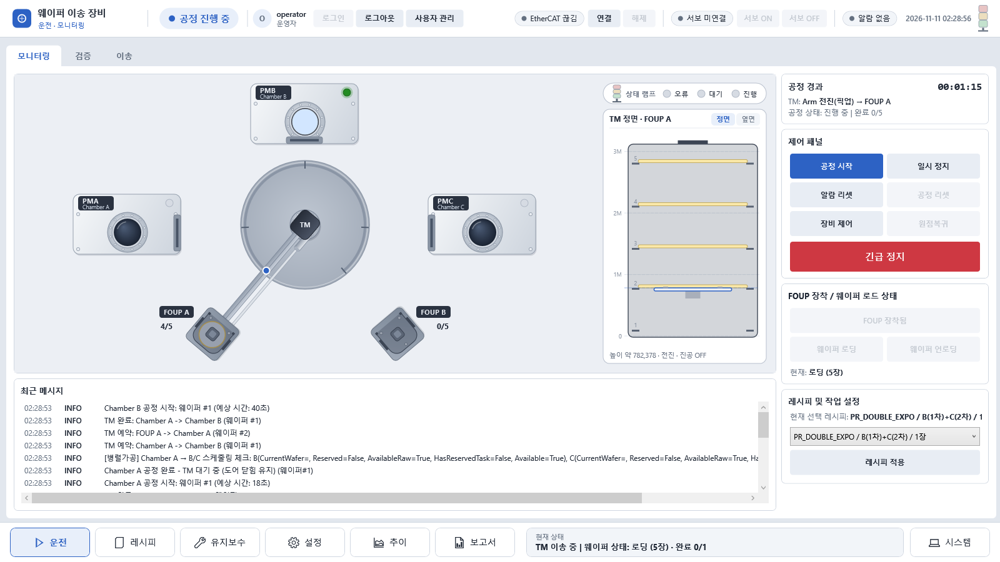
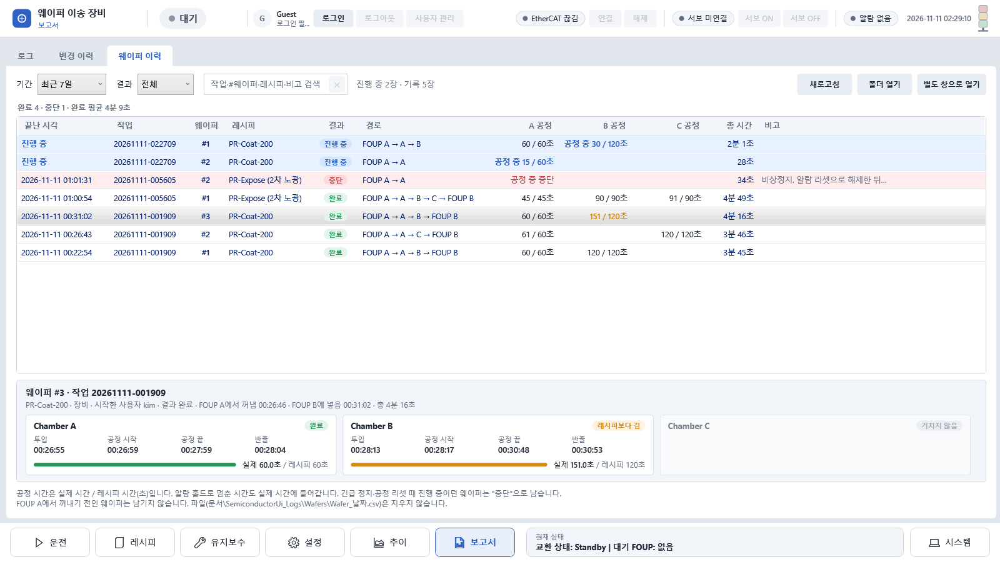

# Semiconductor UI (WPF) - 웨이퍼 이송 장비 HMI, WPF·MVVM 이식판

> 📂 [포트폴리오 (Notion)](https://iced-tarsier-455.notion.site/350af40f5e6680d19f93f1653925a3b8) · 🔗 원본: [SemiconductorUi (WinForms)](https://github.com/yaong832/SemiconductorUi)

실장비(EtherCAT)에서 돌아가는 WinForms HMI [SemiconductorUi](https://github.com/yaong832/SemiconductorUi)를 **.NET 8 WPF + MVVM**으로 옮긴 프로젝트입니다.
화면과 장비 로직을 분리해서, 원본에서는 메인 폼 안에 있던 공정 진행 로직을 UI 없이 테스트할 수 있게 만드는 것이 목표입니다.



---

## 📌 현재 상태

| 항목 | 상태 |
| --- | --- |
| 용도 | 포트폴리오·구조 연구용. **실장비에서는 원본 WinForms 버전을 씁니다.** |
| 원본 반영 시점 | 원본 [`9e7ca9e`](https://github.com/yaong832/SemiconductorUi/commit/9e7ca9e) (PR #75, 2026-11-24)까지 |
| 실장비 검증 | 안 함. 시뮬레이션 모드와 단위 테스트, CI 화면 스냅샷으로만 확인 |
| 아직 안 옮긴 것 | 없음. 원본 11-17 안전 잠금(공정 중 로그아웃·연결 해제·종료 차단, 원점복귀 중 잠금, 서보 OFF 뒤 재원점 강제)과 추이 챔버 그래프까지 옮김 |

> ⚠️ **실장비에서 실행할 때**
> - exe는 **32비트(x86)** 로 만들어집니다. 장비 DLL(`IEG3268_Dll.dll`)이 cifX 드라이버 핸들을 32비트 정수(UInt32)에 담아서, 64비트 프로세스에서는 핸들이 잘리기 때문입니다. 원본 exe도 .NET Framework 기본값(32비트 선호)으로 32비트로 실행됩니다.
> - 장비 PC에 **.NET 8 Desktop Runtime (x86)** 을 설치하거나, `dotnet publish src/SemiconductorUi.Wpf -c Release -r win-x86 --self-contained`로 런타임을 함께 배포하세요.
> - 64비트로 띄우면(예: `dotnet SemiconductorUi.Wpf.dll`) EtherCAT 연결을 막고 시뮬레이션으로만 동작합니다. 실행 중인 비트 수는 '시스템' 화면에 나옵니다.
> - 실장비 검증은 아직 안 했습니다. 처음에는 웨이퍼 없이, 속도를 낮추고, 비상정지를 바로 누를 수 있게 준비한 상태에서 시험하세요.

---

## 🔁 원본과 비교해서 나아진 점

| | 원본 (WinForms, .NET Framework 4.7.2) | 이 프로젝트 (WPF, .NET 8) |
| --- | --- | --- |
| 공정 진행 로직 | 메인 폼(`Form1.cs`, 8,500줄) 안에 있음 | `Core/Process/ProcessEngine.*` 로 분리, UI 없이 실행 가능 |
| 화면 코드 | 폼 이벤트 핸들러에서 장비 직접 호출 | ViewModel + Command, `MainWindow.xaml.cs` 19줄 |
| 테스트 | 156개 (안전 규칙·저장소 위주) | 246개 (공정 엔진 시뮬레이션 테스트 포함) |
| UI 의존성 | 로직에 `WinForms.Timer`, `System.Drawing.Color` 섞임 | `ITickTimer`, `ArgbColor`로 UI와 분리 |
| CI | Windows 빌드·테스트 (2026-11 추가) | 빌드 → 테스트 → **화면 스냅샷 PNG 자동 생성** |

---

## 🛡️ 옮겨 온 안전 장치

원본의 안전 규칙은 `Core/Hardware/`에 그대로 옮기고 테스트도 함께 가져왔습니다.

- 화면 긴급 정지: 두 축 서보 OFF, 도어·실린더·진공 OFF 출력 차단 (`EmergencyStopPolicy`)
- 회전·실린더 인터락: 실린더가 전진해 있으면 회전 금지, 회전 완료 전 실린더 전진 금지 (`TmMotionInterlock`)
- 원점복귀 순서: 실린더 후진 상태에서 상하 → 회전 순서 (`ResetHomingSequence`)
- 서보 알람 감시, EtherCAT 통신 감시 (`ServoFaultMonitor`, `EthercatCommWatchdog`)

## 🧰 화면

운전(모니터링·검증·이송 탭) · 레시피 · 유지보수(I/O 모니터, 유지보수 카운터) · 설정(티칭, 속도, 설정 백업) · 추이 · 보고서(로그, 변경 이력, 웨이퍼 이력) · 시스템 · 사용자 관리 · 장비 상세 창 · 장비 직접 제어 창



전체 화면 스냅샷은 CI가 PR마다 [`ci-snapshots` 브랜치](https://github.com/yaong832/SemiconductorUiWPF/tree/ci-snapshots)에 올립니다.

---

## 📂 구성

| 프로젝트 | 대상 | 설명 |
|---|---|---|
| `src/SemiconductorUi.Core` | net8.0 | UI 무관 로직: `Hardware`(EtherCAT/IEG3268, 안전 규칙), `Process`(공정 엔진), `Controllers`(TM 상태 머신, 챔버), `Services`(로그·이력·백업), `Repositories`(XML) |
| `src/SemiconductorUi.Wpf` | net8.0-windows | WPF 화면 (MVVM): `Views`, `ViewModels`, `Controls`(장비 캔버스), `Infrastructure`(RelayCommand, DispatcherTickTimer) |
| `tests/SemiconductorUi.Core.Tests` | net8.0 | MSTest 246개 |
| `tools/SnapshotTool` | net8.0-windows | 장비 없이 주요 화면을 PNG로 렌더링 (CI에서 사용) |
| `lib/IEG3268_Dll.dll` | | 장비 통신 DLL (원본과 동일) |

### 원본 대비 바뀐 점 (Core)

- `System.Windows.Forms.Timer` → `ITickTimer` 인터페이스 (WPF는 `DispatcherTickTimer`)
- `System.Drawing.Color` → UI 독립 `ArgbColor` (WPF에서 `ToMediaColor()`/`ToBrush()`로 변환)
- `EquipmentRegion` 열거형을 Controls에서 Core로 이동 (네임스페이스 유지)
- `ExceptionHandler`의 MessageBox → `ExceptionHandler.ShowErrorMessage` 훅

---

## ▶️ 빌드와 실행

.NET 8 SDK가 필요합니다. 실행은 Windows에서만 되고, exe가 32비트라서 **.NET 8 Desktop Runtime (x86)** 도 있어야 합니다. 시뮬레이션만 볼 때는 `dotnet src/SemiconductorUi.Wpf/bin/Debug/net8.0-windows/SemiconductorUi.Wpf.dll`로 64비트 런타임에서 띄워도 됩니다 (EtherCAT 연결은 막힘).

```
dotnet build SemiconductorUi.Wpf.sln
dotnet test SemiconductorUi.Wpf.sln
dotnet run --project src/SemiconductorUi.Wpf
```

EtherCAT `연결`을 누르지 않고 로그인 → FOUP 장착 → 웨이퍼 로딩 → 레시피 적용 → 공정 시작을 하면 시뮬레이션으로 공정이 진행됩니다. 기본 계정과 화면 사용법은 원본의 [사용자 가이드](https://github.com/yaong832/SemiconductorUi/blob/main/사용자_가이드/README.md)와 같습니다.

화면 스냅샷 만들기:

```
dotnet run --project tools/SnapshotTool -- snapshots
```
